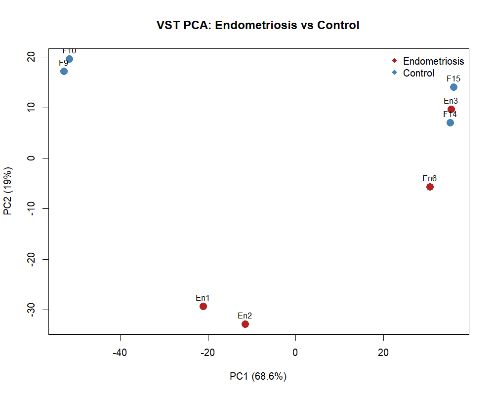
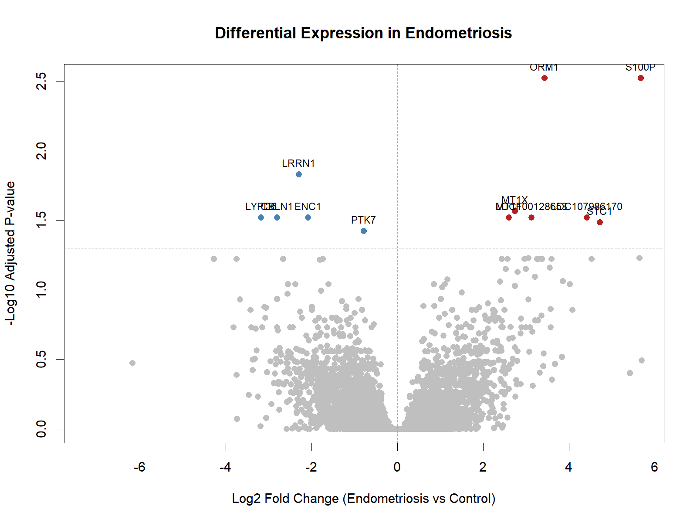
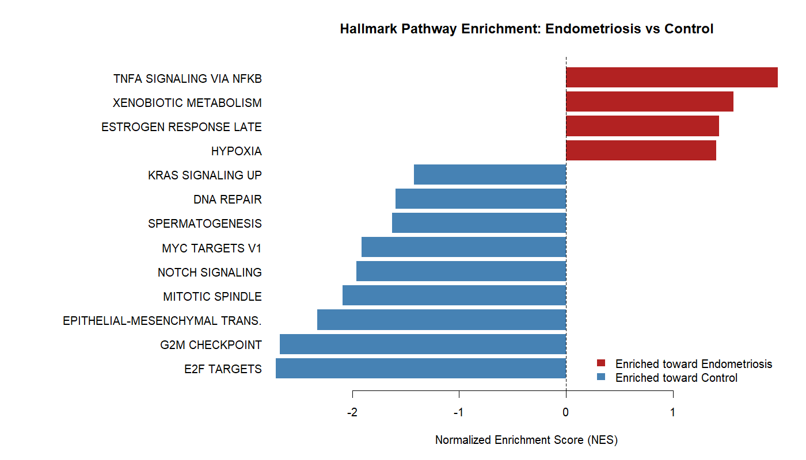

# Endometriosis Transcriptomics Analysis

Endometriosis is a common condition in which endometrial-like tissue grows outside the uterus, and the molecular signals that distinguish affected endometrium from unaffected endometrium are still not well characterised. This project takes publicly available RNA-seq data and asks that question directly, with a reproducible workflow built end to end.

## Overview

This project analyzes publicly available RNA-seq data to investigate transcriptomic differences associated with endometriosis.

Using the NCBI GEO dataset GSE153740, I developed a reproducible workflow to compare mid-secretory eutopic endometrial samples from women with endometriosis and controls (n = 4 per group, 8 samples total).

The analysis includes sample-level quality assessment, differential gene expression using DESeq2, gene annotation, and ranked gene-set enrichment analysis using MSigDB Hallmark pathways. A replication stage testing whether the discovery signals hold in independent cohorts has since been added (see [Replication](#replication)).

Given the small discovery cohort, results are interpreted as exploratory rather than as clinically validated biomarkers. The full reasoning behind that interpretation is in [Interpretation](#interpretation) and [Limitations](#limitations).

## Research Questions

- Do endometriosis and control samples show distinct global transcriptomic patterns?
- Which genes differ in expression between endometriosis and control samples?
- Which biological pathways show coordinated enrichment across the ranked transcriptome?
- How should gene- and pathway-level findings be interpreted given sample-level heterogeneity and limited cohort size?
- Do the gene- and pathway-level signals replicate in independent cohorts?

## Analysis Workflow

1. Selected and evaluated human endometriosis RNA-seq dataset GSE153740
2. Reviewed sample metadata and experimental design
3. Assessed sequencing depth and filtered low-count genes
4. Applied variance-stabilizing transformation for sample-level PCA
5. Performed differential expression analysis with DESeq2
6. Annotated gene-level differential-expression results
7. Ranked genes using DESeq2 Wald statistics
8. Performed Hallmark gene-set enrichment analysis with fgsea and MSigDB
9. Generated PCA, volcano, and pathway-enrichment visualizations
10. Assessed replication in GSE6364 (Affymetrix, mid-secretory, 9 vs 8)
11. Assessed candidate-gene drift across secretory cycle stages in GSE234354

## Tools

| Category | Tools |
|---|---|
| Analysis (R) | R, DESeq2, fgsea, msigdbr / MSigDB Hallmark gene sets, limma, GEOquery, org.Hs.eg.db |
| Analysis (Python) | pandas, NumPy, matplotlib / seaborn |
| Environment | Jupyter Notebook, Git / GitHub |

## Results Summary

### Sample-level variation

Variance-stabilizing transformation followed by PCA showed substantial sample-level heterogeneity. PC1 and PC2 explained 68.6% and 19.0% of the total variance, respectively (87.6% combined).

Endometriosis and control samples did not separate by disease status. The endometriosis group itself split: En1 and En2 separated from En3 and En6, and En3 sat between two control samples (F14, F15) with En6 nearby, while the remaining controls (F9, F10) sat far from every other sample on PC1. Sample-level heterogeneity, rather than disease status, was the dominant source of global transcriptomic variation in this cohort.



### Differential expression

Differential expression analysis was performed using DESeq2 on NCBI-generated raw gene counts.

Genes were retained if they had at least 10 counts in at least 4 samples. At an adjusted p-value threshold of 0.05:

- 12 genes were differentially expressed
- 11 of the 12 carry a gene symbol
- of those, 6 showed higher expression in endometriosis and 5 showed lower expression

Two of the twelve differentially expressed features are uncharacterised loci rather than named genes. LOC100128653 is a long non-coding RNA at 7p22.3 with no described function; LOC107986170 is likewise listed as an uncharacterised locus and has no Entrez-to-symbol mapping, which is why it is absent from the symbol-annotated view of the results. Their biological relevance is unknown, so they are not discussed further in the interpretation. The complete results table is in `results/tables/`.



### Pathway enrichment

Ranked gene-set enrichment analysis was performed using the DESeq2 Wald statistic and MSigDB Hallmark gene sets.

Thirteen Hallmark pathways were significant at FDR < 0.05: four enriched toward endometriosis and nine enriched toward control.

Enriched toward endometriosis:

- TNF-alpha/NF-kB signaling
- Xenobiotic metabolism
- Late estrogen response
- Hypoxia

Enriched toward control:

- KRAS signaling up
- DNA repair
- Spermatogenesis
- MYC targets V1
- Notch signaling
- Mitotic spindle
- Epithelial-mesenchymal transition
- G2M checkpoint
- E2F targets



## Replication

### GSE6364: mid-secretory eutopic endometrium, 9 vs 8 (Affymetrix)

Analysis used limma on log2 intensities. The GEO series matrix is on the linear scale, so intensities were transformed with log2(x + 1); quantile normalisation was omitted because the data are already RMA-processed. Probes were mapped to gene symbols and duplicate symbols collapsed.

| Measure | Result |
| --- | --- |
| Samples analysed | 17 (9 endometriosis, 8 control) |
| Genes at FDR < 0.05, array-wide | 2 |
| Candidate genes testable | 11 of 12 |
| Candidate genes concordant in direction | 4 of 11 (chance ≈ 5.5) |
| Best candidate p-value | LOC100128653, p = 0.006, FDR = 0.66 |

Discovery log2 fold changes for the panel run 2.1–5.7; in GSE6364 the same genes run 0.04–0.64, a five- to ten-fold attenuation. Six of eleven candidates flipped direction, including three of the strongest discovery signals: S100P (+5.68 → −0.64), STC1 (+4.73 → −0.35) and MT1X (+2.74 → −0.34).

### GSE234354: secretory-stage drift in 114 non-disease biopsies

GSE234354 is the bulk RNA-seq from a 206-woman endometriosis cohort (143 cases, 63 controls). The GEO release carries cycle stage, age, pod and batch for all 290 samples, but not endometriosis case/control status, so the per-sample disease test could not be run. An independent check was possible on the 114 biopsies at secretory stages 5–7 (one biopsy per woman), which tests whether the candidate genes drift with cycle timing in tissue unselected for disease.

| Gene | stage 5 | stage 6 | stage 7 | Δ (7−5) |
| --- | --- | --- | --- | --- |
| MT1X | 10.56 | 10.36 | 8.32 | −2.24 |
| MT1F | 10.40 | 10.45 | 9.15 | −1.25 |
| LYPD6 | 6.74 | 5.26 | 5.81 | −0.93 |
| S100P | 7.23 | 8.91 | 6.39 | −0.84 |
| ORM1 | 5.54 | 5.70 | 4.80 | −0.74 |
| LRRN1 | 7.30 | 6.37 | 6.77 | −0.53 |
| ENC1 | 8.93 | 8.66 | 9.43 | +0.50 |
| STC1 | 9.59 | 11.10 | 9.84 | +0.26 |
| CBLN1 | 5.28 | 5.58 | 5.21 | −0.07 |

Values are median variance-stabilising-transformed expression (DESeq2 VST, blind = TRUE), one biopsy per woman. Cycle stage definitions follow the GSE234354 series description: stage 5 = days 16–19, stage 6 = days 20–23, stage 7 = days 24–28 of a standardised 28-day cycle. MT1X and MT1F vary more across the secretory phase than any other candidate, and both are among the highest expressed genes in the panel. The metallothionein signal is therefore confounded with secretory-phase timing, and plausibly with sample handling. CBLN1, STC1, ENC1 and LRRN1 are comparatively stable across stages, so cycle timing is an unlikely explanation for those genes.

### Across three cohorts

| Cohort | Design | Result |
| --- | --- | --- |
| GSE153740 (discovery) | 4 vs 4 RNA-seq | No separation by disease status; 12 DEGs at FDR < 0.05 |
| GSE6364 | 9 vs 8 array, mid-secretory | 2 genes at FDR < 0.05 array-wide; 4 of 11 candidates concordant |
| GSE234354 | 27 vs 14 RNA-seq, mid-secretory | Not run; per-sample disease labels absent from the GEO release |

Two independent cohorts fail to detect a disease effect of the magnitude implied by the discovery analysis. Combined with the absence of separation in the discovery PCA, the most parsimonious reading is that the 12-gene set is a set of hypotheses generated in an underpowered cohort (n = 4 per group), and that some members, in particular S100P, STC1, MT1X and MT1F, are likely to be artefacts of that design rather than disease biology.

This does not invalidate the discovery analysis, but it bounds it: any effect in mid-secretory eutopic endometrium is small enough that neither a 9-vs-8 array cohort nor a 4-vs-4 RNA-seq cohort detects it reliably. The 27-vs-14 mid-secretory subset of GSE234354 is the smallest cohort in which a meaningful replication attempt can be made.

### What would settle it

Request the GSM-to-case/control mapping for GSE234354 from the dataset authors. A lookup table of 259 GSM IDs against biopsy names is prepared as `data/external/GSE234354/sample_id_lookup.csv`; adding one case/control column to it would be all that is required. With disease labels in hand, the discovery pipeline can be run on 27 cases and 14 controls, the highest-powered test available from public data on this question.

## Interpretation

The discovery cohort does not show clear global transcriptomic separation by disease status, and its small sample size limits statistical power and generalizability. The gene-level and pathway-level signals it identified should be read as hypotheses generated in that cohort, not as findings that survive independent testing.

That reading is now supported by the replication stage. In an independent mid-secretory cohort (GSE6364, 9 vs 8), the 12-gene panel does not replicate in direction, and the effect sizes attenuate five- to ten-fold. A separate check in 114 biopsies not selected for disease shows that the metallothionein genes (MT1X, MT1F), two of the strongest discovery signals, vary substantially across the secretory phase itself, which makes them poor candidates for disease-specific markers in whole-tissue samples.

These findings should be considered exploratory and should not be interpreted as clinically validated biomarkers.

## What I Would Do Next

- Obtain endometriosis case/control labels for GSE234354 and run the discovery pipeline on its 27-vs-14 mid-secretory subset. This is the highest-powered test available from public data and the one that would settle whether the gene and pathway signals hold.
- Add covariate adjustment for cell-type composition, which is a plausible confounder in whole-tissue endometrial samples. Public single-cell references such as the Human Endometrial Cell Atlas make this feasible, and it would also test whether the metallothionein signal is compositional.
- Use cycle-stage-aware covariates, or a molecular staging estimate, rather than relying on histological dating, given the stage-dependent drift measured in MT1X and MT1F.
- Target any surviving candidate genes with a targeted assay (for example qPCR) rather than relying on a single small RNA-seq cohort.
- Investigate whether the two uncharacterised loci correspond to functional transcripts in endometrial tissue.

## Repository Structure

```
data/                  Dataset documentation and metadata
data/external/         External cohort files, cohort manifest, sample ID lookup
notebooks/             Exploratory analyses and notebooks
src/                   Reusable analysis scripts
results/               Generated figures and analysis outputs
results/replication/   Replication outputs and concordance tables
```

## Dataset

This project uses GSE153740 from the NCBI Gene Expression Omnibus (GEO), a bulk RNA-seq dataset of mid-secretory eutopic endometrial samples.

The analysis includes:

- 4 samples from women with endometriosis
- 4 control samples
- 8 samples total

Exploratory analysis uses the submitter-provided transcript-level expression matrix. Formal differential-expression analysis uses the NCBI-generated gene-level raw count matrix because DESeq2 requires count data rather than normalized FPKM values.

### Replication datasets

- **GSE6364**: Affymetrix U133 Plus 2.0 microarray, eutopic endometrium from women with laparoscopy-proven moderate-to-severe endometriosis and controls, across proliferative, early secretory and mid-secretory phases. 17 mid-secretory samples used (9 endometriosis, 8 control).
- **GSE234354**: bulk RNA-seq of eutopic endometrium from 206 women (143 endometriosis cases, 63 controls) across menstrual cycle phases. Cycle stage, age, pod and batch are available for all 290 samples in the GEO release; per-sample endometriosis status is not, so only the cycle-stage drift check was run.

## Data Source and Citation

This project analyzes the publicly available GSE153740 RNA-seq dataset from the NCBI Gene Expression Omnibus (GEO). The dataset contains mid-secretory phase eutopic endometrial samples from women with endometriosis (n = 4) and controls without endometriosis (n = 4).

GEO accession: GSE153740 | BioProject: PRJNA643840 | SRA: SRP269814

The original study processed RNA-seq reads using a workflow including Cutadapt, HISAT2, Cufflinks, and Cuffdiff and provided transcript-level FPKM expression estimates. This project uses the submitter-provided transcript expression matrix for exploratory analysis and the NCBI-generated gene-level raw count matrix for the DESeq2 differential expression workflow. Because the gene-level counts were generated independently by NCBI rather than by reproducing the original study's transcript-level pipeline, results from this analysis are not expected to exactly reproduce the published results.

### Original Study

Bane K, Desouza J, Shetty D, et al. Endometrial DNA damage response is modulated in endometriosis. *Human Reproduction*. 2021;36(1):160–174. doi:10.1093/humrep/deaa255. PMID: 33246341.

### Replication Study Datasets

- GSE6364: Burney RO, Talbi S, Hamilton AE, Vo KC, Nyegaard M, et al. Gene expression analysis of endometrium reveals progesterone resistance and candidate susceptibility genes in women with endometriosis. *Endocrinology*. 2007.
- GSE234354: Mortlock S, Kendarsari R, Fung JN, et al. Tissue specific regulation of transcription in endometrium and association with disease. *Human Reproduction*. 2020.
- GSE234354 cycle-stage definitions: Teh WT, Chung J, Holdsworth-Carson SJ, et al. A molecular staging model for accurately dating the endometrial biopsy. *Nature Communications*. 2023;14(1):6222. doi:10.1038/s41467-023-41979-z. PMID: 37798294.

## Reproducibility

Exploratory data analysis is documented in:

```
notebooks/01_data_exploration.ipynb
```

The R workflow for differential expression, annotation, and pathway enrichment is implemented in:

```
src/deseq2_analysis.R
```

Replication analyses are implemented in:

```
src/microarray_concordance.R   # GSE6364 limma workflow and candidate concordance
src/run_replication.R          # GSE234354 metadata, stage-drift check, gated disease test
```

From the repository root, the analyses can be run with:

```
Rscript src/deseq2_analysis.R
Rscript src/microarray_concordance.R
Rscript src/run_replication.R
```

`src/run_replication.R` runs the secretory-stage drift check without any additional input. The GSE234354 disease test is gated on a `disease_labels.csv` file (ID column plus case/control column); until that file exists, the script writes metadata and runs the stage check only.

Key output tables are available under `results/tables/`, replication outputs under `results/replication/`, and generated figures under `results/figures/`.

R and Bioconductor package versions used for the analysis are recorded in `results/sessionInfo.txt` and, for the replication stage, in `results/replication/sessionInfo_GSE234354.txt`.

External data files are not committed to the repository; accessions and download instructions are recorded in `data/external/cohort_manifest.csv`.

## Limitations

This analysis is exploratory and has several important limitations:

- The discovery cohort is small, with 4 endometriosis and 4 control samples.
- PCA does not show clean global separation between disease groups in the discovery cohort. Endometriosis samples En3 and En6 sit near two controls, so a single sample or two can shift the group-level picture.
- The analysis now includes an independent validation cohort (GSE6364, mid-secretory, 9 vs 8), whose gene-level result disagrees with the discovery: 2 genes at FDR < 0.05 array-wide, and 4 of 11 candidates concordant in direction, which is indistinguishable from chance (binomial p = 0.55).
- The metallothionein signal (MT1X, MT1F) is confounded with secretory-phase timing. In 114 independent biopsies not selected for disease, MT1X and MT1F vary more across stages 5→7 than any other candidate (−2.24 and −1.25 VST units), so the signal should not be read as disease biology.
- The GSE234354 27-vs-14 mid-secretory comparison has not been run, because the GEO release lacks per-sample disease labels. It is the highest-powered test available from public data.
- GSE6364 is a microarray platform and its controls are described as women without endometriosis or with normal endometrial pathologies; platform and control-definition differences limit how strictly the two cohorts can be compared.
- NCBI-generated gene-level counts are used for differential expression and may differ from the transcript-level quantification used in the original study.

Differentially expressed genes and enriched pathways should therefore be treated as hypotheses for further investigation rather than diagnostic or clinically validated biomarkers.
